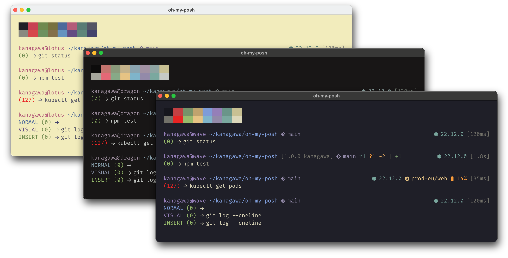
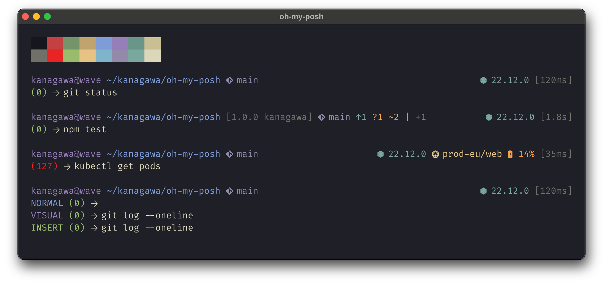
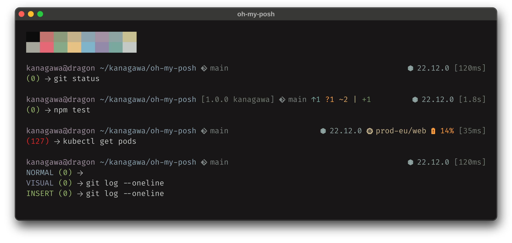
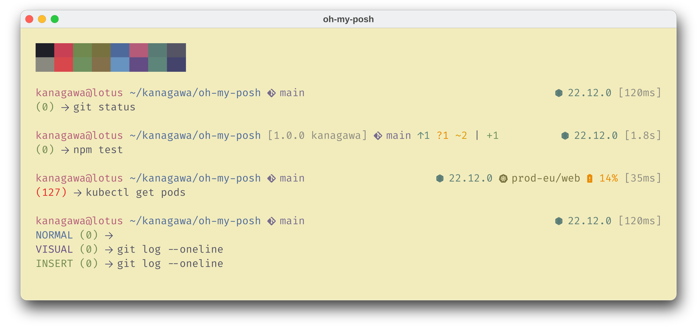

<h3>Kanagawa for <a href="https://ohmyposh.dev">Oh My Posh</a></h3>
<p>A community-maintained theme inspired by Hokusai's <em>The Great Wave off Kanagawa</em>.</p>
<p>Using the <a href="https://github.com/rebelot/kanagawa.nvim">Kanagawa palette</a> by <a href="https://github.com/rebelot">Tommaso Laurenzi (rebelot)</a>.</p>

<p>Based on <a href="https://github.com/JanDeDobbeleer/oh-my-posh/discussions/4414">the Kanagawa theme</a> by <a href="https://github.com/sravioli">sravioli</a>.</p>

<!-- Wave accents: carpYellow, crystalBlue, autumnRed. Lotus accents: lotusYellow, lotusBlue4, lotusRed. -->
<p>
  <a href="https://github.com/kanagawa-community/oh-my-posh/stargazers">
    <picture>
      <source media="(prefers-color-scheme: dark)" srcset="https://img.shields.io/github/stars/kanagawa-community/oh-my-posh?style=for-the-badge&amp;labelColor=1F1F28&amp;color=E6C384">
      <source media="(prefers-color-scheme: light)" srcset="https://img.shields.io/github/stars/kanagawa-community/oh-my-posh?style=for-the-badge&amp;labelColor=F2ECBC&amp;color=77713F">
      
    </picture>
  </a>
  <a href="https://github.com/kanagawa-community/oh-my-posh/releases/latest">
    <picture>
      <source media="(prefers-color-scheme: dark)" srcset="https://img.shields.io/github/v/release/kanagawa-community/oh-my-posh?style=for-the-badge&amp;label=release&amp;labelColor=1F1F28&amp;color=7E9CD8">
      <source media="(prefers-color-scheme: light)" srcset="https://img.shields.io/github/v/release/kanagawa-community/oh-my-posh?style=for-the-badge&amp;label=release&amp;labelColor=F2ECBC&amp;color=4D699B">
      
    </picture>
  </a>
  <a href="https://github.com/kanagawa-community/oh-my-posh/issues">
    <picture>
      <source media="(prefers-color-scheme: dark)" srcset="https://img.shields.io/github/issues/kanagawa-community/oh-my-posh?style=for-the-badge&amp;labelColor=1F1F28&amp;color=C34043">
      <source media="(prefers-color-scheme: light)" srcset="https://img.shields.io/github/issues/kanagawa-community/oh-my-posh?style=for-the-badge&amp;labelColor=F2ECBC&amp;color=C84053">
      
    </picture>
  </a>
</p>

<br clear="both">
<br>

## Previews



<details>
<summary>🌊 Wave</summary>

</details>

<details>
<summary>🐉 Dragon</summary>

</details>

<details>
<summary>🪷 Lotus</summary>

</details>

## Requirements

- Oh My Posh, tested with 32.0.0.
- A terminal with truecolor and a [Nerd Font](https://www.nerdfonts.com/). The prompt uses Nerd Font icons.

## Installation

Download the themes into `~/.config/oh-my-posh/themes`:

```sh
mkdir -p ~/.config/oh-my-posh/themes
for variant in wave dragon lotus dynamic; do
  curl -fsSL -o ~/.config/oh-my-posh/themes/kanagawa-$variant.omp.json https://raw.githubusercontent.com/kanagawa-community/oh-my-posh/main/themes/kanagawa-$variant.omp.json
done
```

Or clone the repository and run `./install.sh`. It installs all three variants and the dynamic theme,
or only the ones you name, for example `./install.sh dragon lotus`. `./uninstall.sh`
takes the same names and removes them.

## Usage

Pass a theme to `oh-my-posh init` in your shell configuration:

```sh
# bash and zsh
eval "$(oh-my-posh init bash --config ~/.config/oh-my-posh/themes/kanagawa-wave.omp.json)"

# fish
oh-my-posh init fish --config ~/.config/oh-my-posh/themes/kanagawa-wave.omp.json | source
```

```powershell
# PowerShell
oh-my-posh init pwsh --config ~/.config/oh-my-posh/themes/kanagawa-wave.omp.json | Invoke-Expression
```

For zsh, use `init zsh`. For other shells, see the
[Oh My Posh documentation](https://ohmyposh.dev/docs/installation/prompt). Use
`kanagawa-dragon` or `kanagawa-lotus` for the other variants.

### Dynamic theme

`kanagawa-dynamic` has the same prompt as the three variants and holds all three
palettes. It picks one from two environment variables. Both values must be in
lowercase.

| `KANAGAWA_MODE` | `KANAGAWA_DARK` | Palette |
| --------------- | --------------- | ------- |
| `light`         | any             | Lotus   |
| other or unset  | `dragon`        | Dragon  |
| other or unset  | other or unset  | Wave    |

`KANAGAWA_MODE` chooses between light and dark. `KANAGAWA_DARK` chooses which
dark palette you get: Wave (default) or Dragon. Use this theme when your
terminal switches between a dark and a light theme. Set the variables before the
prompt draws, for example in your shell configuration or in your terminal theme
switcher:

```sh
export KANAGAWA_DARK=dragon   # bash and zsh: use Dragon as the dark palette
export KANAGAWA_MODE=light    # bash and zsh: use Lotus now
set --global --export KANAGAWA_DARK dragon   # fish
```

Oh My Posh does not detect the system light or dark mode. Something else must set
`KANAGAWA_MODE`. The prompt reads the variables each time it draws, so a change
shows in the next prompt. A variable you set in one shell does not change other
shells.

The prompt has two lines.

- Line 1, left:
  - User and host, working directory, and project version.
  - Git: the branch, ahead and behind counts, `?` untracked, `~` modified,
    `-` deleted, `X` unmerged, `+` added, and `*` stashed.
  - Jujutsu: the change ID, with `+`, `~`, and `-` counts. In a Jujutsu
    repository, the git state is hidden.
  - Mercurial: the branch, with `+`, `~`, `-`, and `?` counts.
- Line 1, right. An item shows only when it applies to the current directory
  or shell.
  - Runtime version, in the `lang` color: Node.js, Python, Go, Rust, Java, .NET,
    PHP, Ruby, Lua, Zig, Deno, Bun, Kotlin, Swift, Dart, Elixir, Haskell,
    OCaml, Julia, R, Perl, Clojure, Crystal, Nim, and Fortran. A runtime that
    is not installed is hidden.
  - Tool context, in the `tool` color: Docker, kubectl, AWS, Azure, Azure
    Developer CLI, Google Cloud, Terraform, Pulumi, Helm, Argo CD, Firebase,
    Talos, and `nix-shell`. The default Docker context, Terraform workspace,
    and kubectl namespace are hidden. A kubectl context shows only its last
    path part and at most 30 characters.
    The Pulumi stack is cached for 30 seconds in each directory.
  - Battery: only when it discharges below 20%. It uses the `diag-warning`
    color, and the `diag-error` color below 10%.
  - Execution time of the last command.
- Line 2:
  - Vi mode, only in normal (`NORMAL`, also while an operator is pending),
    visual (`VISUAL`), and replace (`REPLACE`) mode. The colors follow the
    Neovim theme: `mode-normal` for normal, `diag-ok` for insert, and
    `mode-visual` for visual. It needs Vi key bindings in your shell:
    `bindkey -v` in zsh, `fish_vi_key_bindings` in fish, or
    `Set-PSReadLineOption -EditMode Vi` in PowerShell. In fish, the segment replaces
    `fish_mode_prompt`. In PowerShell, it replaces the cursor-shape mode
    indicator. The cursor is a steady bar in insert mode and a steady block in
    the other modes. Without Vi key bindings, the theme does not change the
    cursor.
  - Exit code of the last command.
  - Prompt character.

A command that spans several lines shows `...` in the `dim` color on each
continuation line. Oh My Posh supports this in bash, zsh, and PowerShell, not in
fish.

## Customization

The themes read these variables. Each default keeps the prompt as described
above.

| Variable           | Default | Effect                                                                  |
| ------------------ | ------- | ----------------------------------------------------------------------- |
| `battery_low`      | `20`    | The battery shows when it discharges below this percentage.             |
| `battery_critical` | `10`    | Below this percentage, the battery uses the `diag-error` color.         |
| `trunc`            | `30`    | The most characters of a kubectl, Azure, Google Cloud, or Argo CD name. |
| `status_always`    | `true`  | `false` shows the exit code only after a failed command.                |
| `exec_threshold`   | `0`     | The execution time shows only for commands that take this many ms.      |
| `session_always`   | `true`  | `false` shows user and host only in an SSH session or as root.          |
| `show_project`     | `true`  | `false` hides the project version.                                      |
| `vim_cursor`       | `true`  | `false` stops the theme from changing the cursor shape.                 |
| `vim_show_insert`  | `false` | `true` shows `INSERT` in insert mode.                                   |
| `vim_short`        | `false` | `true` shows one letter for the Vi mode: `N`, `V`, `R`, or `I`.         |
| `vim_brackets`     | `false` | `true` puts the Vi mode in brackets, such as `[N]` or `[NORMAL]`.       |

To change them, make your own file that extends a theme, and set only the
variables you change. Use your file in `oh-my-posh init`, not the theme:

```json
{
  "extends": "kanagawa-wave.omp.json",
  "version": 4,
  "var": { "battery_low": 30, "session_always": false, "vim_short": true }
}
```

A relative `extends` path is relative to your file. Variables merge by name, so
your file needs only the ones you change. Keep each variable at the top level of
`var`: a nested object replaces the whole object.

## Palette

Every color comes from the shared
[palette](https://github.com/kanagawa-community/.github/blob/main/docs/PALETTE.md),
picked by role, so each variant uses its own value for the same role. Each theme
defines these names in its `palette`, and your own segments can use them with
`p:<name>`, for example `p:diag-error`.

| Oh My Posh name                                                       | Palette role                               |
| --------------------------------------------------------------------- | ------------------------------------------ |
| `black`, `red`, `green`, `yellow`, `blue`, `magenta`, `cyan`, `white` | `term.black` to `term.white`               |
| `bright-black` to `bright-white`                                      | `term.bright_black` to `term.bright_white` |
| `git-added`, `git-removed`, `git-changed`                             | `vcs.added`, `vcs.removed`, `vcs.changed`  |
| `diag-ok`, `diag-error`, `diag-warning`, `diag-info`, `diag-hint`     | `diag.ok` to `diag.hint`                   |
| `special`                                                             | `ui.special`                               |
| `dim`                                                                 | `syn.comment`                              |
| `lang`                                                                | `syn.type`                                 |
| `tool`                                                                | `syn.identifier`                           |
| `mode-normal`                                                         | `syn.fun`                                  |
| `mode-visual`                                                         | `syn.keyword`                              |

## Accessibility

Contrast ratios are measured against the `ui.bg` of each variant, for the colors
the prompt uses.

- Wave: 3.2:1 or more. `git-removed` is 3.2:1, `dim` is 3.3:1, and
  `diag-error` is 3.7:1. The other colors are above 4.5:1 or close to it.
- Dragon: 3.5:1 or more. `git-removed` is 3.5:1 and `diag-error` is 4.0:1.
- Lotus: 2.0:1 or more, because the palette uses light colors on a light
  background. `git-changed` is 2.0:1, `diag-warning` is 2.2:1, `dim` is 2.9:1,
  `git-added` is 3.0:1, `diag-ok` is 3.3:1, and `bright-cyan` is 3.4:1. Seven more
  are between 3.6:1 and 4.1:1.

The theme does not change a palette color to improve this. To change a color,
open an issue in the
[.github repository](https://github.com/kanagawa-community/.github/issues).

## Credits

This port is based on the
[Kanagawa theme](https://github.com/JanDeDobbeleer/oh-my-posh/discussions/4414)
that sravioli published for Oh My Posh in 2023. That theme used version 2 of the
configuration format. This port uses version 4, takes its colors from the shared
palette by role, and keeps the layout. The colors come from
[kanagawa.nvim](https://github.com/rebelot/kanagawa.nvim) by Tommaso Laurenzi.

## Issues and contributions

Report bugs and request changes in this port's
[issue tracker](https://github.com/kanagawa-community/oh-my-posh/issues). Contributions are welcome.

See [CONTRIBUTING.md](CONTRIBUTING.md) before opening a pull request.

## License

MIT. See [LICENSE](LICENSE).
